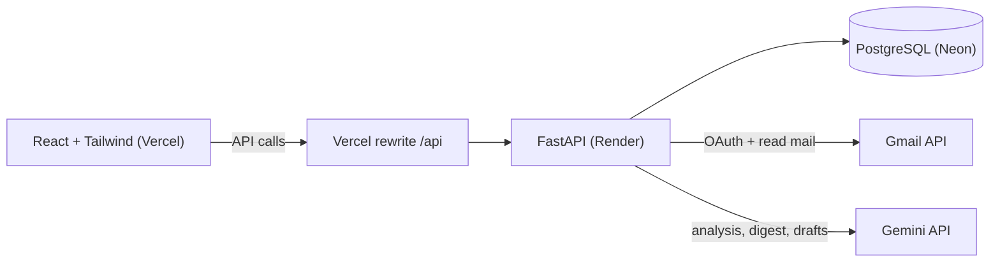

# AI Email Intelligence Assistant

An AI assistant that connects to your Gmail, then sorts and summarizes your emails and pulls out tasks and deadlines, all in one dashboard.

**Live demo:** https://email-intelligence-assistant.vercel.app

Gmail access runs in Google's test mode, so only approved accounts can sign in. To try it, send me your Gmail address and I'll add you. The first load can take about a minute because the free server sleeps when idle.


## What it does

- Sign in with Google (OAuth 2.0 with state and PKCE checks)
- Syncs your latest emails in the background with live progress, on a button or automatically every 5 minutes
- Gemini reads each email once and returns a category, a short summary, whether you need to act, what to do, and the deadline
- Task list sorted by deadline, with overdue tasks highlighted
- Category tabs with counts
- AI digest: one short summary of your recent emails
- Draft replies in three tones. You review and copy them; nothing is ever sent automatically

## Architecture



## Tech stack

| Layer | Technology |
|---|---|
| Frontend | React, Vite, Tailwind CSS |
| Backend | Python, FastAPI, SQLAlchemy, Alembic |
| Database | PostgreSQL (Neon); SQLite works locally |
| AI | Google Gemini API (JSON mode) |
| Auth | Google OAuth 2.0, signed HttpOnly cookie sessions |
| Hosting | Vercel, Render, Neon |

## Engineering decisions

- **One AI call per email.** A single prompt returns category, summary, action item and deadline as JSON. It is cheaper than four calls and keeps the answers consistent.
- **Rate limits handled.** The free Gemini tier allows 5 requests per minute, so calls are throttled and retried with backoff on 429/503 errors. A circuit breaker stops a sync if Gemini keeps failing. Failed emails are not saved, so the next sync retries them.
- **Prompt tuned on real mail.** The first prompt flagged 7 of 10 sample emails as needing action, almost all marketing. Category definitions and stricter rules brought it to 0 of 10. Deadlines are resolved against the date each email was sent.
- **Background sync.** `POST /sync` returns immediately and the browser polls progress. Each email is saved as soon as it is analyzed.
- **List first, download only what is new.** Sync lists message IDs, skips the ones already stored, and downloads only new emails.
- **Security.** OAuth state and PKCE checks. A signed, HttpOnly, SameSite session cookie. Every query is scoped to the logged-in user. Email text is shown as plain text, never as HTML. Email content is fenced as untrusted input in prompts, and AI replies are drafts only.
- **Migrations.** Alembic, with early migrations collapsed into one baseline before the first PostgreSQL deploy.
- **Same-origin deployment.** Vercel rewrites `/api/*` to Render, so the browser sees one site and the session cookie stays first-party.

## Run it locally

```bash
git clone https://github.com/RAVADA-LAKSHITHA/email-intelligence-assistant.git
cd email-intelligence-assistant

# Backend
cd backend
python -m venv venv
venv\Scripts\activate          # macOS/Linux: source venv/bin/activate
pip install -r requirements.txt
cp .env.example .env           # then fill in the values
alembic upgrade head
fastapi dev app/main.py

# Frontend (new terminal)
cd frontend
cp .env.example .env
npm install
npm run dev
```

You need a Google Cloud project with the Gmail API enabled and an OAuth **Web application** client. Add `http://localhost:8000/api/auth/google/callback` as a redirect URI, add the `gmail.readonly` and `gmail.modify` scopes, and add your Gmail as a test user. Use `localhost`, not `127.0.0.1`.

## Environment variables (backend)

| Name | Purpose |
|---|---|
| `GOOGLE_CLIENT_ID`, `GOOGLE_CLIENT_SECRET` | Google OAuth client |
| `GOOGLE_REDIRECT_URI` | Where Google sends users after login |
| `FRONTEND_URL` | Where users land after login, also used for CORS |
| `DATABASE_URL` | PostgreSQL URL, or `sqlite:///./email_assistant.db` locally |
| `GEMINI_API_KEY`, `GEMINI_MODEL` | Gemini access and model name |
| `GEMINI_MIN_INTERVAL_SECONDS` | Gap between Gemini calls (13 for the free tier) |
| `SYNC_MAX_EMAILS` | How many recent emails each sync looks at |
| `SECRET_KEY` | Signs session cookies. Keep it secret. |
| `SESSION_DAYS`, `COOKIE_SECURE`, `COOKIE_SAMESITE` | Session cookie settings |

## Limitations

- Free hosting: the server sleeps when idle, and the first request after that is slow.
- Gmail access is in Google's test mode, so only approved test users can sign in.
- The free Gemini tier is slow for a big first sync, about 13 seconds per new email.
- Sync looks at the latest 25 emails only. Sync progress is kept in server memory.
- The app asks for the `gmail.modify` scope but currently only reads mail.

## Roadmap

- Automated tests and CI
- Mark tasks as done
- Sync older mail and paginate
- Narrow the OAuth scope to read-only
- Move sync to a Celery + Redis queue for larger scale
- Safe rendering of HTML emails